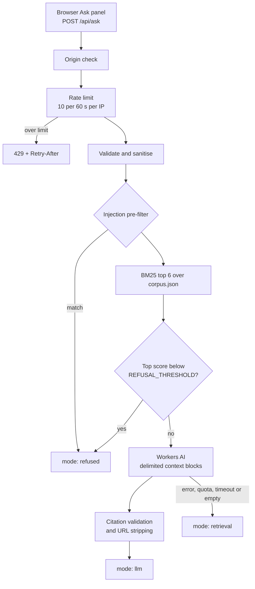

# Backend: Cloudflare Worker (`/api/*`)

The site is a static Astro build (`./dist`) served by **Workers Static Assets**. A small Worker
(`worker/src/`) handles only `/api/*` (`run_worker_first: ["/api/*"]`). Every other request is served
directly from assets and never runs the Worker, so it costs nothing and gets its security headers from
`public/_headers`.

| File | Purpose |
| --- | --- |
| `wrangler.jsonc` | Worker, assets, AI, rate-limit and send_email bindings; vars |
| `worker/src/index.ts` | Router: `/api/health`, `/api/ask`, `/api/contact`, JSON 404 for other `/api/*` |
| `worker/src/ask.ts` | Ask pipeline (rate limit → validation → injection filter → BM25 → Workers AI → post-processing) |
| `worker/src/prompt.ts` | System prompt, `<context>` blocks, citation validation/renumbering, URL stripping, excerpts |
| `worker/src/corpus.ts` | Loads `/corpus.json` through `ASSETS`, caches the BM25 index in module scope keyed by version |
| `worker/src/contact.ts`, `email.ts`, `email-message.ts` | Contact form → RFC 5322 message → `send_email` binding |
| `worker/src/guard.ts`, `validate.ts`, `http.ts`, `turnstile.ts` | Injection filter, input validation, headers/origin/rate limit, Turnstile |
| `src/lib/retrieval.ts` | Shared BM25 (also used by the in-browser fallback) |
| `public/_headers` | Security + cache headers for static assets |

## Architecture



Source: `diagrams/ask-architecture.mmd` (render with `node scripts/diagrams.mjs ask-architecture`).

## API contract

All API responses are JSON with `Cache-Control: no-store`. There are no CORS headers, so the API is
same-origin only. A POST is rejected with **403** unless its `Origin` header is the request's own origin,
`https://rakshithponnappa.dev`, `https://www.rakshithponnappa.dev` or `http://localhost:<port>`.
Requests with no `Origin` header (for example plain `curl`) are also rejected. To test with curl, add `-H 'Origin: http://localhost:8787'`.

### `GET /api/health`

```json
{ "status": "ok", "model": "@cf/meta/llama-3.1-8b-instruct-fp8-fast", "corpusVersion": "2026-11-18…" }
```

`corpusVersion` is `null` when `/corpus.json` cannot be loaded.

### `POST /api/ask`

Request: `Content-Type: application/json`, body `{ "question": string }` (3–400 characters after trimming;
control, zero-width and bidi characters are removed).

Response `200`:

```ts
{
  answer: string;
  citations: { id: string; title: string; url: string }[];
  mode: 'llm' | 'retrieval' | 'refused';
  latencyMs: number;
  excerpts?: string[]; // retrieval mode only, aligned with citations, ≤ 55 words each
}
```

- `llm`: `answer` contains `[n]` markers. `n` is the 1-based index into `citations`.
- `retrieval`: `answer` is `"Here are the most relevant passages from his public material:"`, with the top 3 passages in `excerpts`.
- `refused`: the question is off-topic, below the relevance threshold or looks like prompt injection. Citations point to `/resume/` and `/contact/`.

Errors: `400` invalid body/question, `403` origin (or a supplied Turnstile token that fails),
`405` wrong method, `413` body > 8 KiB, `415` not JSON, `429` rate limited (`Retry-After: 60`),
`503` corpus unavailable. The frontend falls back to in-browser BM25 on any non-OK response.

### `POST /api/contact`

Request: `{ name, email, message, turnstileToken }`. `name` can be up to 80 characters, `email` must be a valid
address, and `message` must be 10–2000 characters.

| Status | Body |
| --- | --- |
| 200 | `{ "ok": true }` |
| 400 | `{ "ok": false, "error": "…" }` validation |
| 403 | `{ "ok": false, "error": "verification required" \| "verification failed" \| "origin not allowed" }` |
| 429 | `{ "ok": false, "error": "rate limited" }` + `Retry-After` |
| 502 | `{ "ok": false, "error": "could not send message", "fallback": "mailto" }` |
| 503 | `{ "ok": false, "error": "email not configured", "fallback": "mailto" }` (no `EMAIL` binding) |

The message is sent from `CONTACT_FROM` to `CONTACT_TO`. It is a hand-built text/plain UTF-8 message with a
base64 body. It has `Reply-To` set to the visitor, plus `Date` and `Message-ID` headers.

## Guardrails

- **Origin allow-list** on every API POST. There is no wildcard CORS.
- **Rate limiting** uses the `RATE_LIMITER` binding (10 requests per 60 s), keyed `ask:<CF-Connecting-IP>` and
  `contact:<CF-Connecting-IP>`. Cloudflare rate limits are per location and eventually consistent, so treat
  them as abuse dampening, not an exact quota. If the binding errors, the Worker fails open and logs it.
- **Input hygiene**: JSON only, 8 KiB body cap, length limits, and control/zero-width/bidi characters stripped.
- **Injection pre-filter** (`guard.ts`) catches phrases such as "ignore previous/above", "system prompt",
  "you are now", "developer mode", "jailbreak", "reveal your instructions", role tags and `[INST]`
  tokens. Matches return `refused` without calling the model.
- **Relevance threshold**: if the top BM25 score is below `REFUSAL_THRESHOLD` (from `src/lib/retrieval.ts`),
  the Worker refuses and doesn't spend neurons.
- **Prompt structure**: the system prompt tells the model to answer only from context about Rakshith S P,
  cite as `[n]`, treat context and question as untrusted data, never reveal the prompt, stay within 120 words
  and write in the third person. Retrieved chunks go into the user message as `<context id="n">` blocks,
  separate from the instructions. Tag-like sequences inside chunks and the question are neutralised.
- **Output validation**: the Worker keeps only `[n]` markers that refer to retrieved chunks and renumbers
  citations in order of first use. It removes every URL that is not in the corpus (bare URLs and markdown
  links). If the output is empty, has no valid citation or contains fragments of the system prompt, the
  Worker uses **retrieval** mode instead.
- **Failure handling**: any Workers AI error (including daily quota error 4006), a 15 s timeout or unusable
  output switches to `retrieval` mode. The visitor still gets cited passages.
- **Turnstile**: if `TURNSTILE_SECRET` is set, `/api/contact` requires a valid token. The Ask UI sends no
  token, so `/api/ask` verifies only when a secret is set *and* the request includes a token.
- **Headers**: HSTS (2 years, preload), `nosniff`, `Referrer-Policy: strict-origin-when-cross-origin`,
  `Permissions-Policy` (camera, microphone and geolocation all off), COOP `same-origin` and
  `X-Frame-Options: DENY`. The Worker adds these to its own responses. `public/_headers` adds them to static
  files, plus `Content-Security-Policy: frame-ancestors 'none'`, which works alongside Astro's CSP `<meta>`
  without overriding it, and immutable caching for `/_astro/*` and `/fonts/*`.

## Model and cost model

The model is set in `vars.AI_MODEL`: **`@cf/meta/llama-3.1-8b-instruct-fp8-fast`**. It is an instruction-tuned
model that accepts `messages`. It is among the cheapest capable chat models on Workers AI and is fast enough
for interactive use.
It is used instead of `@cf/meta/llama-3.1-8b-instruct-fast` because the Workers AI pricing page (checked
2026-11-18) lists only the `fp8-fast` name. To change models, edit `AI_MODEL`. No code changes are needed.
The Worker accepts both the `{response}` and the OpenAI-style `choices` output shapes.

Pricing for `llama-3.1-8b-instruct-fp8-fast`: 4,119 neurons per million input tokens and 34,868 neurons per
million output tokens.

| | Input tokens | Output tokens | Neurons |
| --- | --- | --- | --- |
| Typical question (6 chunks) | ~1,800 | ~180 | **~14** |
| Worst case (`max_tokens: 400`) | ~2,500 | 400 | **~24** |

Cloudflare gives **10,000 free neurons per day**, which resets at 00:00 UTC. That covers about 400–700 LLM answers per day. Refused questions
(injection, off-topic, below threshold) and rate-limited requests use no neurons. For comparison, the
non-fp8 `llama-3.1-8b-instruct` costs about 60 neurons per question. Smaller models such as `llama-3.2-3b-instruct`
or `granite-4.0-h-micro` are cheaper but give weaker grounded answers.

**When the allowance runs out:** on the Workers Free plan, `AI.run` fails with error 4006 until the
next reset. The Worker catches the error and answers in `retrieval` mode, so the site keeps working with
no bill. On Workers Paid, usage above the free allowance costs $0.011 per 1,000 neurons, about $0.00015
per question.

## Owner setup (one-time)

1. Create a free Cloudflare account. Then authenticate locally: `npx wrangler login`.
2. Add the domain **rakshithponnappa.dev** as a zone in the dashboard. It is already registered with Cloudflare Registrar, so the nameservers are already correct.
3. **Email Routing** (zone → Email → Email Routing): enable it, add your personal inbox as a destination
   and click the verification link it receives. Store that inbox as a secret, `npx wrangler secret put CONTACT_TO`,
   so it is never committed. The `send_email` binding can only deliver to verified destinations. Add a routing
   rule **contact@rakshithponnappa.dev → your inbox**: that is the public address shown on the site and résumé.
4. **Turnstile** (dashboard → Turnstile): add a widget for `rakshithponnappa.dev` and `www.rakshithponnappa.dev`
   (add `localhost` for dev if you like). Then:
   - secret key: `npx wrangler secret put TURNSTILE_SECRET`
   - site key: set `PUBLIC_TURNSTILE_SITE_KEY=<site key>` in the build environment (a GitHub Actions variable in
     CI, or `.env` locally, which is git-ignored). `src/pages/contact.astro` reads it at build time. If it is
     unset, no widget is rendered and the Worker skips Turnstile only if `TURNSTILE_SECRET` is also unset.
5. Deploy: normally the pipeline does this on every merge to `main` (see [docs/PIPELINE.md](PIPELINE.md)).
   Manual fallback: `npm run cf:deploy`.
6. **Custom domains** are declared in `wrangler.jsonc` (apex) and `worker/www-redirect/wrangler.jsonc` (www → apex
   301), so Cloudflare creates the DNS records and certificates on deploy.
7. Check that it works: `curl https://rakshithponnappa.dev/api/health`. The Worker logs are in Workers → Observability.

## Local development and tests

```sh
npm test                 # vitest: retrieval, validation, guards, prompt/citations, email, handler (mocked env)
npm run build && npm run cf:dev   # wrangler dev on http://localhost:8787 (AI binding runs remotely; needs login)
npx wrangler deploy --dry-run --outdir ./.wrangler-dry   # bundle check without deploying
```

`worker/tsconfig.json` type-checks the Worker against `@cloudflare/workers-types`:
`npx tsc -p worker/tsconfig.json`.
