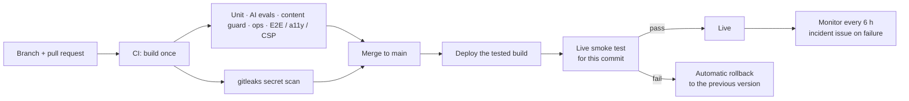

# Delivery pipeline

Every change to rakshithponnappa.com, whether content or code, takes the same path to production. Nothing is deployed by hand
except in an emergency (see [Break glass](#break-glass)).



## Stages

| Stage | Where | What it guarantees |
|---|---|---|
| Build once | `ci.yml` › `test` | `astro build` (with the deploy history pulled from the live site), `status:record`, résumé PDF. That `dist/` is what every later stage tests and what production receives. |
| Unit | `npm test` | Worker handlers, validation, retrieval, rate limiting, email building, hero topology maths. |
| AI | `npm run test:ai` | Retrieval quality on the golden set, refusal of off-topic and adversarial questions, the crawler's view of the site. The same evals publish to [/evals](https://rakshithponnappa.com/evals/). |
| Content guard | `npm run test:content` | No private emails or phone numbers other than the public ones, no internal hostnames or IPs, no client-confidential terms, no unsupported credential claims. Runs over the sources and the built HTML. |
| Ops | `npm run test:ops` | `wrangler.jsonc` bindings and vars (no secrets in config), `_headers`, a deploy dry run, the local Worker stack, a working-tree gitleaks scan, and the pipeline itself (`tests/ops/pipeline.test.ts`). |
| Browser | `npm run test:e2e` | User journeys on Chromium, Firefox, WebKit and mobile, plus axe accessibility, keyboard, motion, CSP-violation and link checks. |
| Secret scan | `ci.yml` › `gitleaks` | Full git history scanned with `tests/ops/gitleaks.toml`. |
| Deploy | `ci.yml` › `deploy` | Runs only on `main`, only after `test` and `gitleaks` pass, one at a time, in the `production` environment. Records the live version, then deploys the downloaded artifact. Nothing is rebuilt. |
| Smoke test | `scripts/smoke.mjs` | Waits until the footer shows the deployed commit, then checks every sitemap page, key files and content types, security headers and CSP, 404 handling, the alias-domain redirects (.dev and www → rakshithponnappa.com), `/api/health`, an on-topic and an off-topic question to the assistant, cross-origin rejection, Turnstile enforcement on the contact form (no email is sent) and that no private email address is published. |
| Rollback | `ci.yml` › `deploy` | If the smoke test fails, `wrangler rollback` restores the previous version (code and assets together), re-runs the smoke test and marks the run failed. |
| Monitor | `monitor.yml` | The same smoke test every 6 hours. A failure opens (or comments on) one `live-incident` issue; the next pass closes it. |
| Dependencies | `dependabot.yml` | Weekly grouped npm and GitHub Actions updates, each going through this same pipeline. |

Branch protection on `main` requires a pull request and the `test` and `gitleaks` checks.

## Making a change

```sh
git switch -c content/short-description
# edit src/data/profile.ts, src/content/**, …
npm test && npm run build && QA_BUILD_DIR=./dist npm run test:content   # fast local loop
git push -u origin HEAD && gh pr create --fill
```

CI runs on the pull request. Merge when it's green and the deploy follows on its own. Run the smoke test against
production at any time with `node scripts/smoke.mjs`.

## One-time setup

| Item | Where | Value |
|---|---|---|
| `CLOUDFLARE_API_TOKEN` | repo secret | A Cloudflare API token from the **Edit Cloudflare Workers** template plus Zone DNS Edit, scoped to this account and the `rakshithponnappa.com` and `rakshithponnappa.com` zones. |
| `CLOUDFLARE_ACCOUNT_ID` | repo variable | The Cloudflare account ID. |
| `PUBLIC_TURNSTILE_SITE_KEY` | repo variable | The Turnstile site key (public by design). |
| `production` environment | repo settings | Restricted to the `main` branch. |

Worker secrets (`TURNSTILE_SECRET`, `CONTACT_TO`) live in Cloudflare, never in the repo. See [BACKEND.md](BACKEND.md).

## Break glass

If CI itself is down and production needs a fix, deploy from a clean checkout of `main` that has passed the tests
locally:

```sh
npm ci && npm test && npm run cf:deploy && node scripts/smoke.mjs
```

To return to the previous version: `npx wrangler deployments list` and `npx wrangler rollback <version-id>`.
